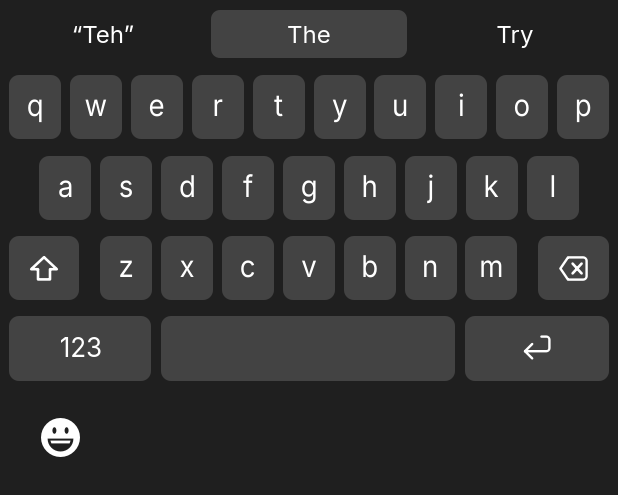
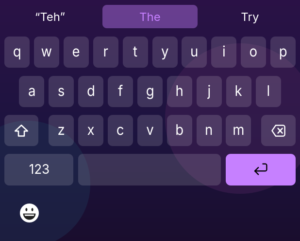
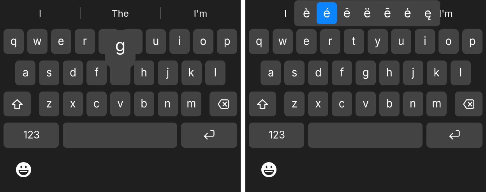
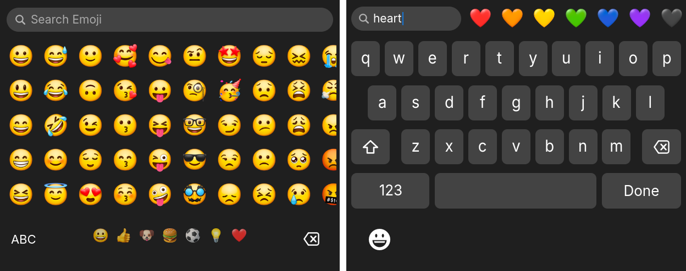

# theOne

An iOS-style on-screen keyboard for Sailfish OS, built as a Maliit input method plugin.
Its dark look is modelled on the iPhone keyboard.

theOne is an independent project, not affiliated with or endorsed by Apple. iOS and iPhone
are trademarks of Apple Inc. theOne uses no Apple artwork or fonts: the font is Inter and
the emoji are Google's Noto Emoji.

| theOne Classic | Sailfish style |
| --- | --- |
|  |  |



- Solid rounded keys, magnified letter balloon while pressing
- Shift: tap for one capital, double-tap for caps lock; automatic capitals at sentence start
- Double space types ". "
- Long-press a letter for accents; long-press or drag the space bar to move the cursor
- English suggestion bar like iOS: the typed word in quotes, the autocorrection
  highlighted, and next-word predictions after a space
- Autocorrect on space, punctuation and return; backspace right after a correction
  undoes it, and the keyboard then keeps that word
- Learns your words and which word tends to follow which (kept in dconf at
  `/apps/theone-keyboard/learned`)
- No suggestions or autocorrect in password, URL, e-mail and number fields
- Number (`123`), symbol (`#+=`) and emoji pages
- Emoji search: tap **Search Emoji** on the emoji page and type a word ("pizza", "heart")
- Optional Sailfish style that follows your ambience, and a Wide key size (see below)
- Settings page: **Settings → System → theOne keyboard**
- Optional swipe typing: slide across the letters to write a word (off by default)
- No haptics, no voice input

Tested on a Sony Xperia 10 V running Sailfish OS 5, plus the desktop preview and a
fake-Maliit test harness.



## Build

The RPM is built on the `sfbuild` VM (Sailfish SDK, target SailfishOS-5.1.0.11):

```bash
scripts/build-rpm.sh
```

The RPM is written to `RPMS/`.

## Install and turn on

Download the `.rpm` from the [releases page](https://github.com/imaxeon-anik/theone/releases),
copy it to the phone (developer mode on) and install it:

```bash
devel-su zypper --non-interactive --no-gpg-checks in theone-keyboard-*.aarch64.rpm
```

Then turn it on in **Settings → System → theOne keyboard**, or as your normal user (not root):

```bash
theone-keyboard on
```

Back to the stock keyboard:

```bash
theone-keyboard off
```

## Style

Two looks, picked in **Settings → System → theOne keyboard** or with the command below.
The keys keep their size, place and behaviour in both; only colours, font and drawing change.

```bash
theone-keyboard style classic    # theOne Classic: dark rounded keys (default)
theone-keyboard style sailfish   # see-through glass keys in the ambience's colours and font
```

**Key size** (Settings, or `theone-keyboard keys standard|wide`): Wide draws every key a
little bigger, with the gaps narrowed from 9 to 6 units. Touches still go to the nearest
key, so the area each key responds to is the same in both sizes.

**Swipe typing** (Settings, or `theone-keyboard swipe on|off`): slide your finger from
letter to letter without lifting it. theOne writes the most likely word and puts its next
guesses in the suggestion bar; tap one to swap it in. The next swipe adds the space by
itself, and backspace right after a swipe removes the whole word. A slide shorter than
about one key still just moves to the neighbouring letter, so for two-letter words on
neighbouring keys ("as", "we") tap instead. Swiping is off in password, URL, e-mail and
number fields.

If the keyboard ever fails to appear, run `theone-keyboard off` over SSH or from a
terminal with a hardware keyboard. Uninstalling the RPM also restores the stock keyboard.

## Develop

- `scripts/preview.sh` renders every keyboard state to `preview/out/` on the VM.
- `python3 scripts/compare.py` compares the letter page with a reference screenshot of your
  own at `preview/local/reference.png` (kept out of the repo).
- `python3 scripts/build_words.py` regenerates `Words.js` from `data/en_50k.txt`.
- `python3 scripts/build_emoji_names.py` regenerates `EmojiNames.js` from Unicode CLDR.
- `tests/test_predict.qml` checks suggestions and autocorrect against common typos.
- `tests/test_swipe.qml` checks the swipe decoder with drawn, wobbly paths.
- `tests/test_emoji.qml` checks emoji search results.
- `tests/test_plugin.qml` drives `plugin/theone.qml` against a fake Maliit server:

```bash
ssh sfbuild 'cd ~/src/theone/tests && QT_QPA_PLATFORM=offscreen QT_QUICK_BACKEND=software qmlscene -I fake -I ../qml test_plugin.qml'
ssh sfbuild 'cd ~/src/theone/tests && QT_QPA_PLATFORM=offscreen QT_QUICK_BACKEND=software qmlscene test_predict.qml'
ssh sfbuild 'cd ~/src/theone/tests && QT_QPA_PLATFORM=offscreen QT_QUICK_BACKEND=software qmlscene test_swipe.qml'
ssh sfbuild 'cd ~/src/theone/tests && QT_QPA_PLATFORM=offscreen QT_QUICK_BACKEND=software qmlscene test_emoji.qml'
```

## Layout

| Path | What |
|---|---|
| `plugin/theone.qml` | Maliit entry point, installed to `/usr/lib64/maliit/plugins/` |
| `qml/org/theone/keyboard/` | The keyboard module, installed to `/usr/share/maliit/plugins/` |
| `qml/org/theone/keyboard/Predict.js` | Suggestions, autocorrect and learning |
| `qml/org/theone/keyboard/Swipe.js` | Swipe typing: matches the drawn path to words |
| `qml/org/theone/keyboard/Words.js` | Generated English word list (do not edit) |
| `qml/org/theone/keyboard/EmojiNames.js` | Generated emoji names and keywords for search (do not edit) |
| `scripts/theone-keyboard` | On/off switch (edits `~/.config/maliit.org/server.conf`) |
| `rpm/theone-keyboard.spec` | Package spec |

## Licence

theOne's code is under the MIT License (`LICENSE`). The bundled parts keep their own licences:

Inter font: SIL Open Font License 1.1 (`qml/org/theone/keyboard/fonts/Inter-LICENSE.txt`).

English word list: [FrequencyWords](https://github.com/hermitdave/FrequencyWords) by
Hermit Dave, built from OpenSubtitles 2018, licensed CC BY-SA 4.0. `data/en_50k.txt` is
the original file; `Words.js` is derived from it and carries the same licence.

Emoji pictures: [Noto Emoji](https://github.com/googlefonts/noto-emoji) 3D set by Google,
downloaded with `scripts/fetch_emoji.py` into `qml/org/theone/keyboard/emoji/` (licence in
`emoji/LICENSE`). Qt 5.6 on Sailfish can't draw colour emoji fonts, so the emoji page shows
these pictures; the emoji you type are still normal text, drawn by the app.

Emoji search words: English emoji names and keywords from
[Unicode CLDR](https://github.com/unicode-org/cldr) (release 49), Unicode License v3.
`scripts/build_emoji_names.py` writes them to `EmojiNames.js`, with the licence at the top.
